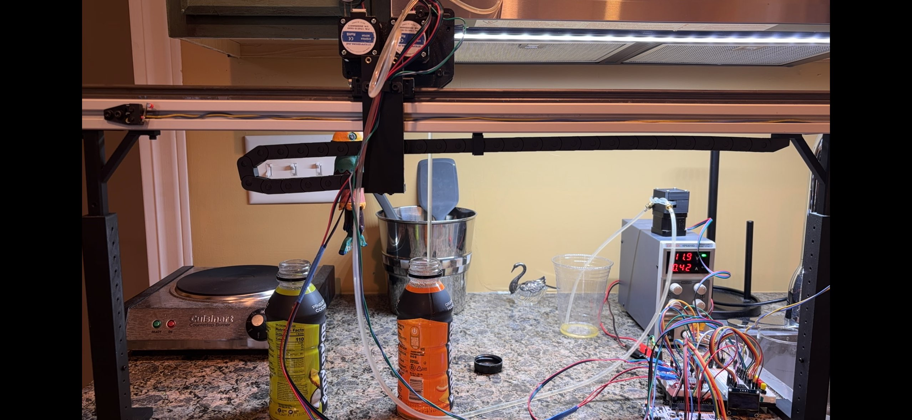

# Drink Processing Robot
## Intro
This is a personal project I started to teach myself the basics of in-depth microcontroller programming for embedded systems. This whole project is in C and is compatible with the STM32 family of microcontrollers. I used PlatformIO to help set up the project and manage build files.

I developed a HAL including stepper motor drivers, EEPROM, SH1106 LCD display, buttons (with debounce), and plan to include more in the future. This corresponds to an actual robot I built (pictured below) including all of these components.

